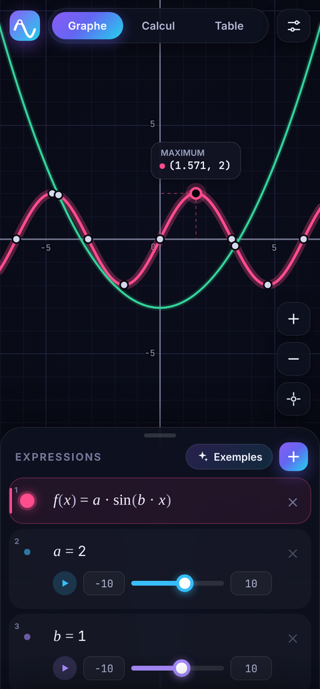
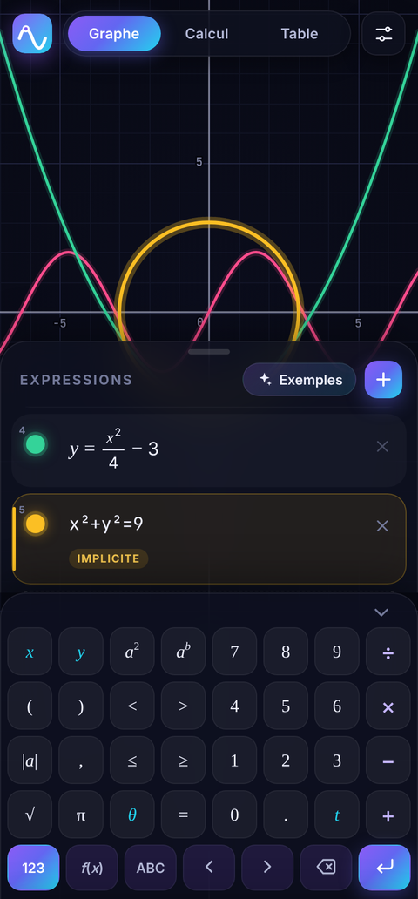
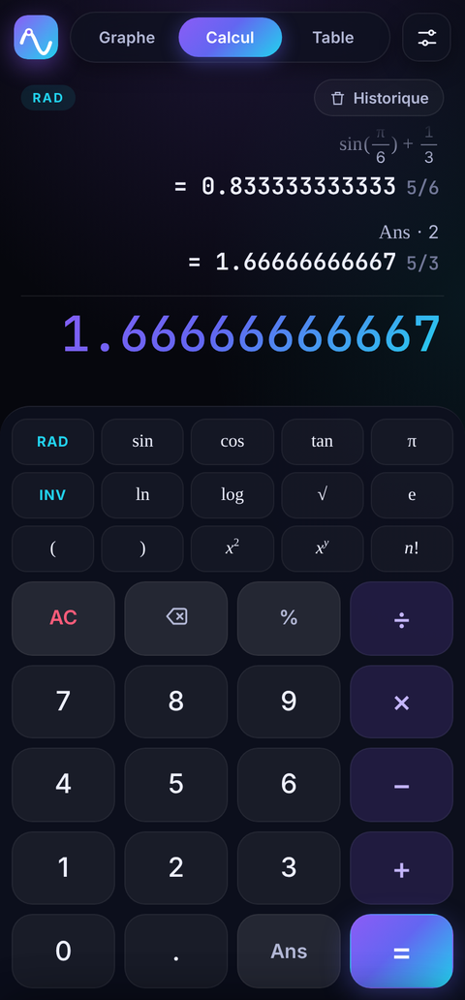
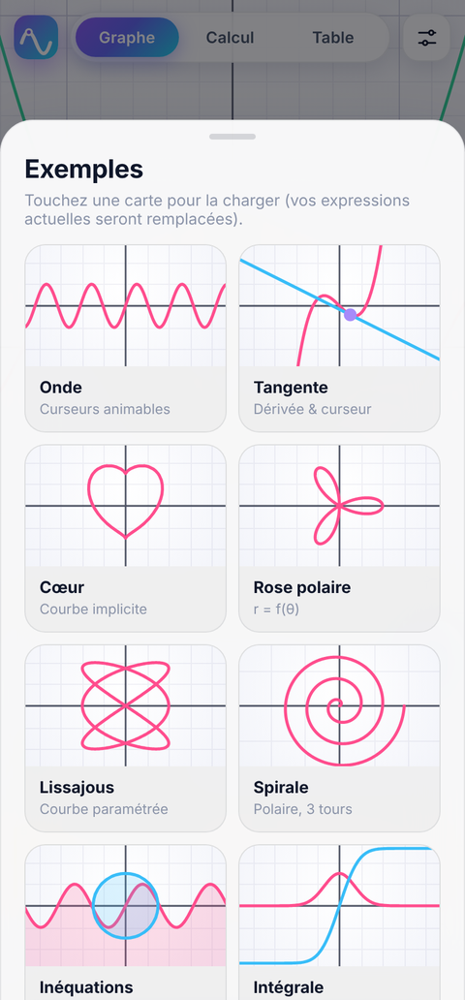

# IA Vidéo — applications Android

Ce dépôt contient deux applications Android compilées automatiquement par GitHub Actions :

| Application | Dossier | Description |
| --- | --- | --- |
| **CINÉ-GENESIS** | `film/` | Studio de création IA : images 4K, vidéos 4K (Kling 3.0, LTX-2.3, Veo 3.1…) et films complets montés en 4K sur le téléphone. |
| **Nova Graph** | `app/` | Calculatrice graphique hors ligne. |

## Télécharger les APK

À chaque push, le workflow **APK Android** compile, signe et publie les deux APK dans la version
[**apk-latest**](../../releases/tag/apk-latest) (lien fixe, toujours à jour) :

- `CineGenesis.apk` — `https://github.com/Idrissta/ia-video/releases/download/apk-latest/CineGenesis.apk`
- `NovaGraph.apk` — `https://github.com/Idrissta/ia-video/releases/download/apk-latest/NovaGraph.apk`

Ouvrez le lien depuis le téléphone, puis le fichier `.apk`, et autorisez l'installation depuis cette source si Android le demande
(Android 8.0 ou plus récent). Les APK sont aussi disponibles comme artefacts de chaque exécution (onglet **Actions**),
et un tag `v*` crée une *Release* versionnée.

---

# CINÉ-GENESIS — studio de films IA en 4K

Version Android de l'application web « CINÉ-GENESIS · Studio de films IA », repensée pour rivaliser avec
Kling AI et Leonardo AI : interface sombre et cinématographique, images jusqu'à 4096 px et vidéos en **4K UHD (3840×2160)**.

### Ce que fait l'application

- **Studio** — création rapide façon Kling / Leonardo :
  - *Image* : prompt + « ✦ Magic prompt », styles, jusqu'à 4 images de référence, formats 16:9 / 9:16 / 1:1 / 4:3 / 3:4,
    1 à 4 variantes. Modèles **Seedream 4.5** (4K natif, jusqu'à 4096 px) et **Nano Banana Pro** (4K), ou Agnès Image.
  - *Vidéo* : image de départ (importée, prise dans la galerie ou générée automatiquement), durée, son natif,
    réplique parlée en français. Modèles **Kling 3.0 4K** et **LTX-2.3 Pro 2160p** (4K natif), **Kling 3.0 Pro** et
    **Veo 3.1** (1080p, montés automatiquement en 4K par l'upscaler **Topaz**), ou Agnès Vidéo.
- **Film** — l'assistant en 7 étapes de l'application d'origine : genre et format, synopsis (10 propositions de l'IA
  à fusionner), personnages (IA ou vos photos), scénario et dialogues, découpage en plans, production vidéo, puis
  **montage 4K sur le téléphone** : tous les plans sont assemblés en un seul MP4 3840×2160 (H.265 ou H.264, 40 à 80 Mb/s),
  agrandis par un filtre bicubique avec renforcement de netteté adaptatif, puis enregistrés dans `Films/CineGenesis`.
- **Galerie** — toutes les créations et films exportés ; enregistrement dans la galerie du téléphone, partage,
  upscale 4K, « Animer » une image, réutiliser un prompt, export 4K local d'une vidéo.
- Tout est sauvegardé sur l'appareil (projets, galerie, générations en cours qui reprennent au redémarrage).

### Clés d'API

L'application n'embarque aucune clé : ajoutez les vôtres dans **Réglages** (elles restent sur le téléphone).

| Fournisseur | Utilisation | Où l'obtenir |
| --- | --- | --- |
| **fal.ai** (recommandé) | Images et vidéos 4K (Seedream, Nano Banana Pro, Kling 3.0, LTX-2.3, Veo 3.1, Topaz) et IA texte | [fal.ai/dashboard/keys](https://fal.ai/dashboard/keys) |
| **Agnès** | Clés de l'application d'origine (texte, images 2K, vidéos 720p) | votre compte Agnès |
| Compatible OpenAI | IA texte au choix : DeepSeek, OpenAI, OpenRouter… | le site du fournisseur |

Les modèles fal.ai sont payants à l'usage (à titre indicatif : Kling 3.0 4K ≈ 0,42 $/s, LTX-2.3 en 2160p ≈ 0,24 $/s,
Seedream 4.5 ≈ 0,04 $/image) ; l'application affiche une estimation avant chaque génération et avant la production d'un film.

### Qualité 4K : comment c'est garanti

1. **4K natif** quand le modèle le permet (Kling 3.0 4K, LTX-2.3 2160p, Seedream 4.5 en 3840×2160 / 4096×4096).
2. Sinon, **upscale IA Topaz** sur fal.ai (option « Upscale automatique en 4K », activée par défaut).
3. Enfin, le **montage local** produit toujours un fichier 3840×2160 (ou 2160×3840 en portrait), quelle que soit la
   source. Si le téléphone ne sait pas encoder la 4K, l'application l'indique et exporte dans la meilleure définition possible.

### Architecture

```
film/src/main/
├── java/com/idrissta/cinegenesis/
│   ├── MainActivity.java   coque native : WebView plein écran, pont JS (réseau sans CORS, galerie, partage, voix…)
│   ├── FilmExporter.java   montage 4K avec Media3 Transformer (téléchargement des plans, encodage HEVC/H.264)
│   └── UpscaleEffect.java  shader OpenGL : agrandissement bicubique Catmull-Rom + netteté adaptative
└── assets/web/
    ├── index.html, css/app.css   interface
    ├── js/core.js       utilitaires, pont natif, stockage IndexedDB, réglages
    ├── js/engines.js    moteurs IA : Agnès (multi-clés), fal.ai (file d'attente), OpenAI-compatible, catalogue de modèles
    ├── js/film.js       assistant de film en 7 étapes et montage 4K
    ├── js/studio.js     studio de création rapide, galerie et visionneuse
    └── js/app.js        navigation, réglages, initialisation
```

Développer l'interface dans un navigateur : `python3 -m http.server 8000 -d film/src/main/assets/web`
(sans le pont natif, l'export 4K et l'enregistrement dans la galerie sont désactivés).
Tests : `node tools/test-film.js`.

---

# Nova Graph — calculatrice graphique pour Android

Calculatrice graphique moderne et hors ligne pour Android : tracé de courbes en temps réel, curseurs animables, calculatrice scientifique et table de valeurs, dans une interface sombre façon « verre dépoli ».

<p align="center">
  
  
  
  
</p>

## Fonctionnalités

**Graphe**
- Fonctions `y = f(x)`, `x = f(y)`, courbes implicites (`x² + y² = 9`), polaires (`r = 2cos(3θ)`), paramétrées (`(cos t, sin t)`) et points.
- Inéquations avec zones colorées (`y < sin(x)`, `x² + y² ≤ 4`) ; frontière en pointillés pour les inégalités strictes.
- Fonctions nommées réutilisables (`f(x) = …`, puis `f(2)`, `f′(x)`, `f″(x)`).
- Curseurs : `a = 2` crée un curseur réglable et animable ; une variable inconnue propose « ＋ Curseur ».
- Zoom à deux doigts, déplacement avec inertie, double appui pour zoomer.
- Suivi de courbe au doigt avec coordonnées et aimantation sur les points remarquables (racines, extremums, intersections, ordonnée à l'origine).
- Asymptotes et discontinuités gérées (tan, 1/x, partie entière…).
- Partage du graphe en image (enregistré dans la galerie).

**Calcul**
- Calculatrice scientifique avec aperçu du résultat en direct, historique, `Ans`, fractions et multiples de π (`0.75 → 3/4`, `1.5708 → π/2`).
- Trigonométrie en radians ou degrés, fonctions inverses (touche INV), factorielle, pourcentages.
- Intégrales `∫(x², 0, 3)`, sommes `Σ(k², k, 1, 10)`, produits, dérivées `d/dx(x³)`.
- Accès aux variables et fonctions définies dans l'onglet Graphe.

**Table** de valeurs pour toutes les fonctions visibles (début et pas réglables).

**Interface** : clavier mathématique intégré (pages 123 / f(x) / ABC en AZERTY), thèmes sombre, clair ou automatique, retours haptiques, bouton retour Android, sauvegarde automatique, affichage mathématique (fractions, exposants, racines).

## Installer l'APK

Voir [Télécharger les APK](#télécharger-les-apk) plus haut. Configuration requise : Android 8.0 (API 26) ou plus récent.

### Signature

Par défaut, les deux APK (Nova Graph et CINÉ-GENESIS) sont signés avec la clé de développement versionnée `app/nova-dev.keystore` (mot de passe public `android`) pour que chaque nouvelle version s'installe par-dessus la précédente. Pour une diffusion publique (Play Store…), utilisez votre propre clé en ajoutant ces secrets au dépôt :

| Secret | Contenu |
| --- | --- |
| `NOVA_KEYSTORE_BASE64` | le keystore encodé en base64 (`base64 -w0 ma-cle.jks`) |
| `NOVA_KEYSTORE_PASSWORD` | mot de passe du keystore |
| `NOVA_KEY_ALIAS` | alias de la clé |
| `NOVA_KEY_PASSWORD` | mot de passe de la clé |

## Compiler localement

Prérequis : JDK 17 et le SDK Android (Android Studio les fournit).

```bash
./gradlew assembleRelease      # → app/…/app-release.apk et film/…/film-release.apk
./gradlew :app:installDebug    # installe Nova Graph sur un appareil connecté
./gradlew :film:installDebug   # installe CINÉ-GENESIS
```

Ou ouvrez simplement le dossier dans Android Studio.

## Architecture

```
app/src/main/
├── java/com/idrissta/novagraph/MainActivity.java   coque native (WebView plein écran, pont JS)
├── assets/web/                                     application
│   ├── index.html, css/app.css                     interface
│   ├── js/math.js        analyse, compilation et calcul numérique (Gauss–Kronrod, dérivées, gamma…)
│   ├── js/workspace.js   expressions, définitions, curseurs, classification des tracés
│   ├── js/graph.js       rendu canvas, gestes, points remarquables
│   ├── js/keypad.js      clavier mathématique
│   └── js/app.js         onglets, calculatrice, table, réglages, persistance
└── res/                                            thème, icône adaptative (thème monochrome inclus)
```

L'interface est servie depuis les assets via une origine locale `https://appassets.androidplatform.net` interceptée par l'application : aucune requête réseau n'est effectuée et tout fonctionne hors ligne. Les polices Inter et JetBrains Mono (licence SIL OFL) sont embarquées.

### Développer l'interface dans un navigateur

```bash
python3 -m http.server 8000 -d app/src/main/assets/web
# puis ouvrir http://localhost:8000 en mode « appareil mobile »
```

### Tests

```bash
node tools/test-math.js   # tests du moteur mathématique (aussi lancés par la CI)
```
